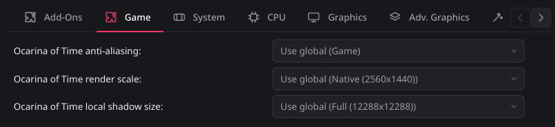
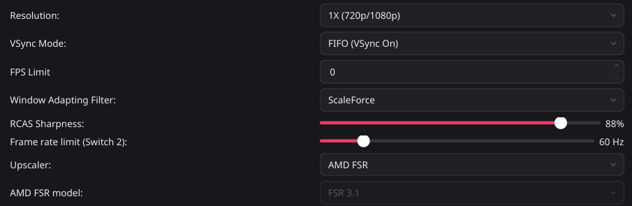
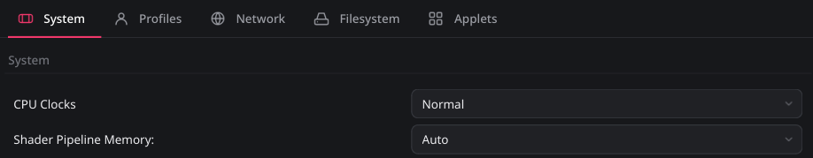
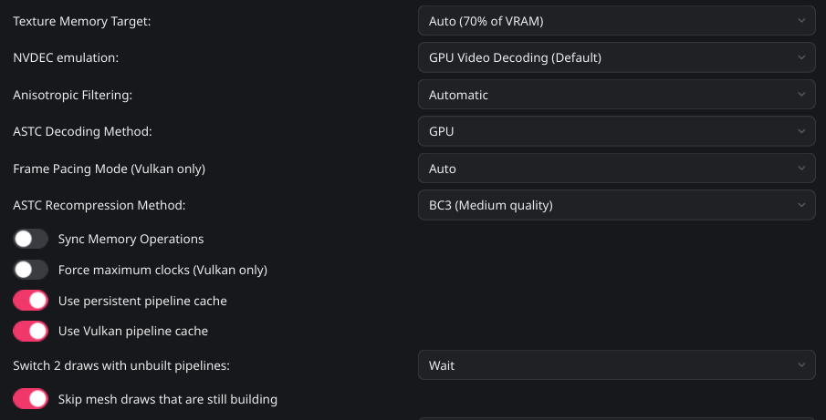
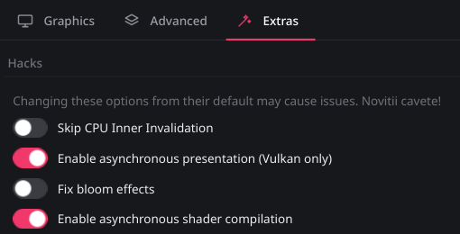
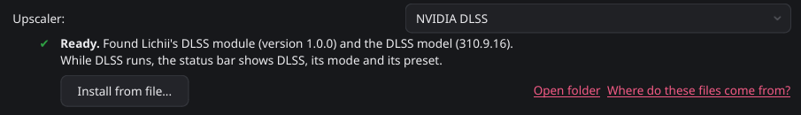

<!--
# SPDX-FileCopyrightText: Copyright 2025 Eden Emulator Project
# SPDX-License-Identifier: GPL-3.0-or-later

# SPDX-License-Identifier: GPL-2.0-or-later
-->

# Lichii (tasarren fork)

A fork of [zortos293/Lichii](https://github.com/zortos293/Lichii), a Nintendo Switch and Switch 2
emulator. This fork works on speed, memory use and stutter, tested mostly with The Legend of Zelda:
Ocarina of Time. It follows Lichii's `nx2` branch; our changes are on the `next` branch.

Downloads: [releases](https://github.com/tasarren/Lichii/releases). Games, keys and firmware are not
included; use only what you legally own.

## Settings for the best speed (Ocarina of Time)

### Pick your PC

Start with the column closest to your setup:

- **Low-end:** A 4 GB graphics card (such as a GTX 1650) and 16 GB RAM, or a Steam Deck.
- **Mid-range:** A 6–8 GB graphics card and 16–32 GB RAM.
- **High-end:** A graphics card with 12 GB or more and at least 32 GB RAM.

| Setting | Low-end | Mid-range | High-end |
|---|---|---|---|
| Shader Pipeline Memory | Low | Low with 16 GB RAM, otherwise Auto | Auto |
| Texture Memory Target | 2 GB | Auto | Auto |
| Ocarina of Time render scale | Performance (1080p) | Balanced (2276×1280) | Native (1440p) |
| Ocarina of Time local shadow size | Quarter | Full, or Half to save memory | Full |
| Upscaler | Native | Native, or try AMD FSR | NVIDIA DLSS on GeForce RTX, otherwise Native or AMD FSR |

A 4 GB card can still run short on video memory with these settings. The Steam Deck shares memory
between the game and graphics. Try the low-end settings there as a starting point, not a promise
of smooth play.

On every PC, start with **Resolution: 1X**, **GPU Mode: Fast**, and **Frame rate limit (Switch 2):
60 Hz**. Turn on **Enable asynchronous shader compilation** and leave **Skip mesh draws that are
still building** on (the default).

### Where to change the settings

Stop the game, then right-click Ocarina of Time in the game list and open **Properties**. Changes
there apply only to this game. Use **Emulation > Configure** if you want to change the defaults.
The screenshots show where to look. The values shown are examples, not a preset.

- **Game:** Set **Ocarina of Time render scale** and **Ocarina of Time local shadow size** here.
  Render scale is how big the game draws the picture. To use it, set **System > Console Mode** to
  **Docked** and enable **Max Resolution (built-in)** under **Add-Ons**. If your graphics card
  struggles, try **Ultra Performance (720p)** next. The picture will be softer. **Half** and
  **Quarter** use less video memory for shadows on nearby objects in towns. Restart the game after
  changing scale or shadows.

  

- **Graphics:** Set **Resolution**, **Frame rate limit (Switch 2)** and **Upscaler** here. An upscaler
  enlarges the picture. **Native** uses the game's own upscaler. In Ocarina of Time, **AMD FSR** and
  **NVIDIA DLSS** only work at **Resolution: 1X**. DLSS quality can override the game's render scale.
  If you raise the limit above 60 Hz, enable **FPS Unlock (built-in)** in **Add-Ons** so the game
  does not run too fast.

  

- **System:** **Shader Pipeline Memory** controls how much work Lichii keeps ready to draw familiar
  scenes. **Low** saves system memory (RAM). Revisiting an area may cause brief pauses or objects
  to appear late while Lichii rebuilds what it needs.

  

- **Adv. Graphics** (**Graphics > Advanced** in the main settings): Set **Texture Memory Target**,
  **GPU Mode** and **Skip mesh draws that are still building** here. The texture target covers only
  images kept for reuse, not all video memory. If a low target causes more pauses and your card has
  room, try **Auto**. **GPU Mode: Accurate** is slower and is not needed for Ocarina of Time.
  If you need more room, **ASTC Recompression Method: BC3** saves video memory at a small cost to
  texture detail.

  

- **Ext. Graphics** (**Graphics > Extras** in the main settings): Turn on **Enable asynchronous
  shader compilation**. This lets Lichii prepare some graphics work while you play.

  

### What to expect when you play

The first time you visit an area, the game can pause for a second or two while Lichii prepares
shaders (the instructions that draw objects and effects). It usually plays more smoothly on later
visits. **Skip mesh draws that are still building** can shorten some pauses, but objects may appear
a moment late. Turn it off if you'd rather wait for them.

In **Adv. Graphics**, keep **Build all cached shaders before game start** on for fewer pauses in
familiar areas, at the cost of a longer load. Leave **Precache shaders before game start** off for
Ocarina of Time. It misses the shaders that cause the longest waits.

In tests with a 60-frame-per-second limit, both Build 3 and Build 4 held that rate in the Market
and at Lake Hylia once shaders were ready. In one first-visit comparison across 15 areas, the
longest pause dropped from 1.9 to 1.6 seconds, but Build 4 spent more time paused overall.

In a separate Build 4 test in the Market at **1X**, Lichii used roughly **9.5 GB of RAM and 5 GB of
video memory** with Auto memory settings and Native render scale. With **Low**, a **2 GB** texture
target and **Performance** render scale together, it used about **8.5 GB of RAM and 4.2 GB of video
memory**. You may see different numbers in other areas or on your PC.

### Set up NVIDIA DLSS on Linux

On Linux, DLSS needs a GeForce RTX card, a compatible NVIDIA driver and the separate
[Lichii DLSS module](https://github.com/tasarren/lichii-dlss/releases).

1. Open **Graphics** and choose **NVIDIA DLSS** under **Upscaler**.
2. Click **Download**. Review NVIDIA's license and accept it to download the module and DLSS files.
3. When the panel says **Ready**, start the game again.

Already have the files? Choose **Install from file...** and select `lichii-dlss-module.so`. Keep
NVIDIA's DLSS model file in the same folder.

## Reporting a problem

Open an [issue](https://github.com/tasarren/Lichii/issues) with the build number, the game, your
CPU, GPU and driver, your settings, and the log (File > Open Lichii Folders > Log Folder) or a Help > Report a Bug
file. Check it for personal information first. Do not upload games, keys or firmware. Bug
bundles, GPU traces, shader dumps, pipeline caches and crash dumps can contain game data: do not
attach them to public reports; ask a maintainer first.

## Building

See the [build guide](docs/Build.md).

## Credits and license

This fork builds on Lichii and the projects it comes from: Eglantine, Eden, yuzu and Sudachi, and
their contributors, including Eglantine's original developer Camille LaVey. Original copyright
notices and third-party licenses are kept. See [LICENSE.txt](LICENSE.txt) and the source files for
the license terms. Not affiliated with Nintendo.
